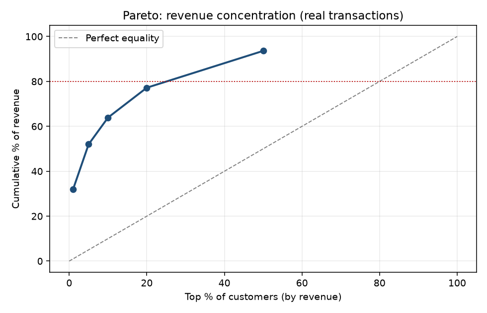
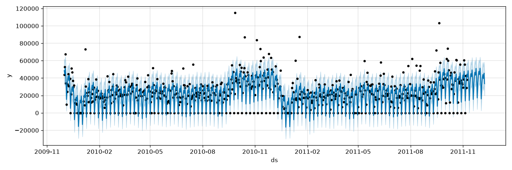

# Retail Intelligence Platform

I made this project to practise doing a whole analysis end to end on real data, instead of the
cleaned-up datasets we got in the course.

The data is [UCI Online Retail II](https://archive.ics.uci.edu/dataset/502/online+retail+ii):
about 1 million transactions from a UK online gift shop between December 2009 and December 2011.
It was messy — missing customer IDs, cancellations, duplicates, negative quantities. I had to clean
it before anything else worked.

Live dashboard: https://retail-intelligence-platform-9epfscsagebft8dgzetlhy.streamlit.app/

## What I did

1. **Cleaned the data.** Removed cancellations, rows without a customer ID, duplicates and invalid
   prices. 1,067,371 rows went down to 779,425 usable ones.
2. **Grouped customers.** Used RFM (recency, frequency, money) and a Gaussian Mixture model to see
   which customers are actually valuable.
3. **Checked retention.** Built monthly cohorts and tested whether repeat buying was changing.
4. **Looked at Black Friday.** Used other countries as a control group to estimate what the sales
   lift actually was.
5. **Forecast sales.** Trained a Prophet model on daily revenue and checked it with cross-validation.
6. **Predicted future big spenders.** Built a Random Forest using only data available before the
   prediction period.

## What I found

- The top 5% of customers bring in **52% of revenue**. The top 20% bring in 77%.
- There are 721 "superstar" customers (12% of the base) who make up **58% of revenue**.
- A smaller group of 64 customers average 80 orders each and spend about £2,900 per basket.
- Repeat buying within 90 days dropped from **85% to 62%** between the earlier and later cohorts.
- Black Friday 2010 was followed by about a **26% increase** in UK weekly revenue.
- The high-value customer model got a **0.905 ROC-AUC**.
- The forecast was about **20% more accurate** than a simple seasonal guess. Tuning the model barely
  helped.





Some of this is good news and some isn't. The revenue concentration and the drop in repeat buying
are problems for the business. The Black Friday result and the prediction model worked well. The
forecast is only okay, partly because I only had two years of data.

## Mistakes I found and fixed

- My first high-value model scored 1.0 ROC-AUC, which was too good to be true. I had used total
  spend both to define the target and as an input. I rebuilt it to predict spend in the *next*
  six months using only earlier behaviour. The real score is 0.905.
- My first retention comparison was misleading because I grouped customers by their last purchase
  date. I changed it to first-purchase cohorts with the same observation window.
- Prophet crashed because days with no sales were missing from the series. I added those days back
  as zero revenue.
- The Black Friday estimate has a caveat: the control-group fit had an R² of 0.49, so I'd treat the
  26% as directional rather than exact.

## Running it

```bash
pip install -r requirements.txt
python src/download_data.py
python src/clean_data.py
python src/run_all.py
streamlit run dashboard/app.py
```

The dashboard works straight after cloning because the small feature tables are in the repo. The
big data files are not — you have to regenerate them with the first three commands.

More detail is in `reports/business_memo.md`.
